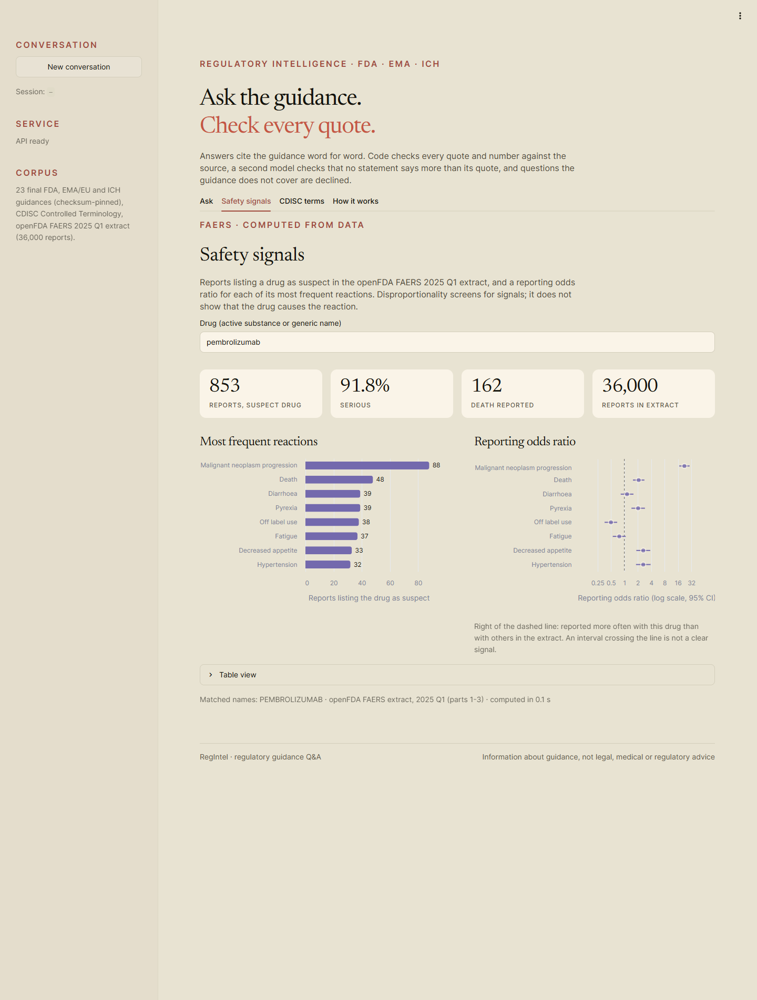

# RegIntel

[](https://github.com/munyaradzi-zhou/RegIntel/actions/workflows/ci.yml)


[](LICENSE)

**Regulatory question answering for biopharma, with every quote and number checked against the source.**

RegIntel answers questions about FDA, ICH and EMA guidance, CDISC terminology, FAERS adverse events, and US drug labels and recalls (live from openFDA). Every quote must appear verbatim in a retrieved passage and every number in a quote, or the statement is removed. When nothing survives, RegIntel declines instead of guessing.


## Architecture


| Component | What it does |
|---|---|
| **Router** | Sends each question to the retrieval pipeline or the research agent; an LLM router by default, or a trained TF-IDF + logistic regression router (MLflow) |
| **Retrieval pipeline** | Azure AI Search agentic retrieval over 1,869 section-aware chunks of 23 guidances, each pinned by sha256; reasoning effort chosen per question shape |
| **Research agent** | Microsoft Agent Framework agent with FAERS (DuckDB, reporting odds ratios computed by parameterised queries), CDISC and live openFDA tools; runs in process or as a Foundry Agent Service agent |
| **Writer → verifier → reviewer** | `gpt-5-mini` writes statements with quotes; code checks every quote and number; `gpt-oss-120b`, a different model family, drops overreach ("should" written as "must") |
| **Guards** | Screens for instruction overrides, prompt extraction and instructions planted in retrieved passages |
| **Audit trail** | Every answer is recorded before release (sources with sha256, models, prompt versions, every verifier and reviewer decision) and hash-chained in Cosmos DB; fails closed. `GET /v1/audit/verify` finds tampering, `scripts/replay.py` re-verifies an answer, and a [validation pack](docs/validation/) traces requirements to tests |

All service-to-service calls use Entra ID through a managed identity; the only secrets are the API keys, generated into Key Vault at deploy time.

## Results on the live deployment

60 golden questions (8 deliberately unanswerable) and 16 data questions, sent over HTTPS to the deployed API.

| | |
|---|---|
| Answerable questions answered | 64 / 68 |
| Unanswerable questions declined | 8 / 8 |
| Expected facts in answers | 102 / 114 |
| Expected source cited | 50 / 52 |
| Data questions answered with tool evidence | 14 / 16 |
| Latency p50 / p95 | 13.4 s / 20.3 s |

What the measurements decided:

- **Section-aware chunking** beat Azure's integrated chunking on every retrieval metric.
- **Reasoning effort by question shape:** `medium` found more evidence for multi-part questions but cost 11 s for no gain on single lookups; routing by shape made single questions ~35% faster.
- **The reviewer** caught 8 of 8 planted overreaches that verbatim checks cannot see, and rejected 0 of 13 good statements.
- **The first live run found a production bug:** blocking calls held the event loop, health probes failed and 15 of 70 requests died; after moving the work to threads, 0 of 70 failed.
- **Four writer families** (gpt-5-mini, grok-4.7, Llama-3.3-70B, DeepSeek-V3.2): grok recalled the most facts at twice the latency; DeepSeek had 42 statements cut, mostly unsupported numbers.
- **Trained router:** 0.83 accuracy offline and free, vs 0.96 for the LLM router at $0.20 per 1,000 questions; the LLM router stays the default.
- **Foundry-hosted agent:** identical answers, ~5 s slower; versioned definitions and portal traces.

Full tables: [docs/evaluation.md](docs/evaluation.md). Decisions and their evidence: [docs/adr/](docs/adr/).



## Costs

Measured from Azure Cost Management and evaluation token counts.

| | |
|---|---|
| Fixed, per month | ≈ €71, 93% of it Azure AI Search (Basic); Container Apps scale to zero, Cosmos DB serverless |
| Per guidance answer | ≈ $0.003 in model calls |
| Per data answer | ≈ $0.002 (prompt caching saves 21%) |

## Run it locally

Requirements: Python 3.11+ and `az login` to a subscription with the Azure resources (or run `scripts/azure/deploy.sh` first).

```bash
python -m venv .venv && source .venv/bin/activate   # Windows: .venv\Scripts\activate
make dev                                             # install with all extras
cp .env.example .env                                 # set the Azure endpoints
make corpus ingest                                   # download the guidances (checksums verified), build chunks
python -m regintel.faers.build                       # FAERS JSON → Parquet
make run                                             # API on :8000 (Swagger at /docs)
make run-ui                                          # UI on :8501
```

## Deploy to Azure

```bash
az login
scripts/azure/deploy.sh
```

Deploys the Bicep templates in [`infra/`](infra), generates API keys into Key Vault, builds and rolls out both images, and runs a smoke test. After CI passes on `main`, [`deploy.yml`](.github/workflows/deploy.yml) redeploys through GitHub OIDC; no Azure credential is stored in GitHub.

## API and MCP

```bash
curl -X POST localhost:8000/v1/ask -H "X-API-Key: $KEY" -H "Content-Type: application/json" \
  -d '{"question": "What is the minimum number of subjects in an EMA bioequivalence study?"}'
```

Every answer carries a grounding label, its sources with verbatim quotes, the path taken, prompt versions and its audit id. Other endpoints: `/v1/ask/stream` (SSE), `/v1/faers/profile`, `/v1/cdisc`, `/v1/audit/verify`. RegIntel is also an MCP server with six read-only tools (`claude mcp add regintel -- python -m regintel.mcp_server`). Details in [docs/api-and-mcp.md](docs/api-and-mcp.md).

## Quality

`make check` runs the CI gates: ruff, mypy `--strict`, 247 unit tests (85% coverage gate), Bandit, pip-audit, gitleaks, Docker builds, Bicep build and shellcheck.

Every pull request also passes an **offline evaluation gate** (`make eval-ci`, no model calls): BM25 retrieval on the golden set, the trained router on held-out questions, 114 recorded drafts replayed through the verifier, and a version check on every changed prompt. A metric that drops more than 0.02 below [the baseline](tests/evaluation/baselines/ci_baseline.json) fails the build. Evaluations with real models run on demand (`make eval-answers`, `eval-agent`, `eval-injection`, ...).

## License

[MIT](LICENSE) © Munyaradzi Zhou
