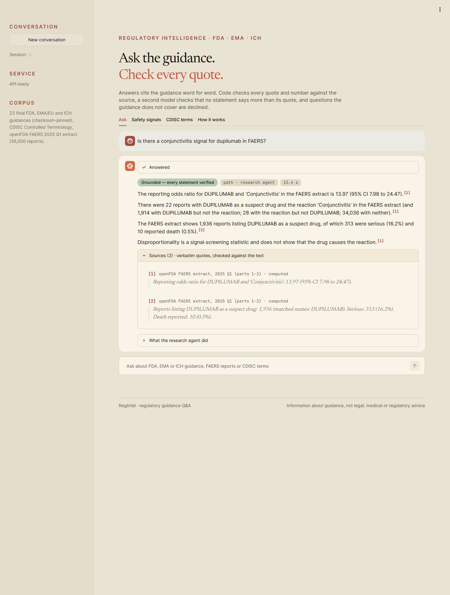
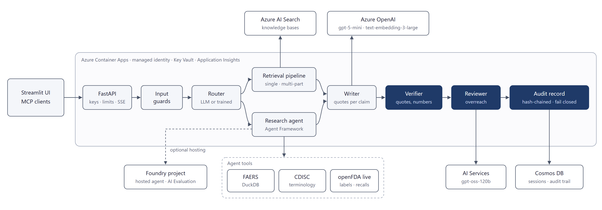
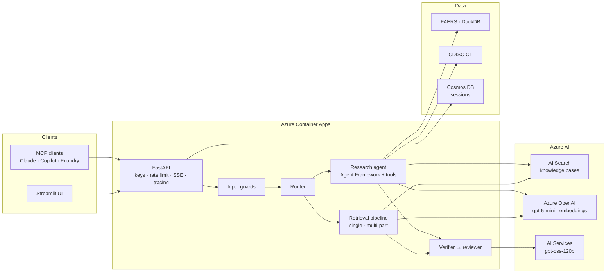

# RegIntel

[](https://github.com/munyaradzi-zhou/RegIntel/actions/workflows/ci.yml)


[](LICENSE)

**Regulatory question answering for biopharma, with every quote and number checked against the source.**
RegIntel answers questions about FDA, ICH and EMA guidance, CDISC terminology and FAERS adverse-event data. A router sends each question to a retrieval pipeline or a tool-using research agent; the answer is then verified in code: a quote that is not verbatim in a retrieved passage, or a number that is not in a quote, is removed before the user sees it. When nothing survives, RegIntel declines instead of guessing.



---

## What it does

| | |
|---|---|
| **Agentic retrieval** | Azure AI Search knowledge bases over 1,869 section-aware chunks of 23 public guidances (FDA, ICH, EMA, European Commission), each pinned by sha256. The planner decomposes multi-part questions into sub-queries; reasoning effort is chosen per question shape (`low` for single lookups, `medium` for comparisons), a choice made from measurements, not defaults. |
| **Grounding enforced in code** | The writer (`gpt-5-mini`, structured output) returns statements, each with verbatim quotes. A verifier checks every quote against the passage text and every number, by value, against the quotes. Unverified statements are dropped; an answer with none left is withheld. |
| **Independent reviewer** | `gpt-oss-120b`, a different model family from the writer, judges each verified statement as supported, overreach or unsupported. It catches what string matching cannot: a "should" written as "must", or a general rule stretched to a subject the source never mentions. |
| **Research agent with data tools** | A Microsoft Agent Framework agent for questions that need data: CDISC Controlled Terminology lookup, and FAERS safety signals over 36,000 reports in DuckDB (counts and reporting odds ratios with 95% CI, computed by parameterised queries, never written by the model). |
| **Guards** | Input screens for instruction overrides and prompt extraction, and a passage screen so retrieved text carrying instructions never reaches the writer. Declined questions get up to three pages from regulator websites, clearly marked as unverified pointers. |
| **Production plumbing** | FastAPI with SSE streaming, API keys and rate limits, follow-up questions in Cosmos DB sessions, OpenTelemetry to Application Insights, an MCP server, and a Streamlit UI. |

## Architecture





Every service-to-service call uses Microsoft Entra ID through a user-assigned managed identity. The only secrets are the API client keys, which are generated at deploy time, stored in Key Vault and never printed.

| Azure service | Used for |
|---|---|
| Azure AI Search | Knowledge bases with agentic retrieval over the section index; a web source restricted to regulator domains for fallback pointers |
| Azure OpenAI | `gpt-5-mini` (router, planner, agent, writer), `text-embedding-3-large` |
| Azure AI Services | `gpt-oss-120b` answer reviewer |
| Container Apps + Container Registry | API and UI, scale to zero |
| Cosmos DB (serverless) | Conversation sessions, 7-day TTL |
| Key Vault · Log Analytics · Application Insights | API keys, logs, traces |

## Running on Azure

Deployed with Bicep and measured over HTTPS against the live API: 60 golden questions (8 deliberately unanswerable) and 10 data questions, sent one at a time as a client would.

| Measured on the live deployment | |
|---|---|
| Answerable questions answered | 58 / 62 |
| Unanswerable questions declined | 8 / 8 |
| Expected facts in answers | 96 / 105 |
| Expected source document cited | 48 / 52 |
| Data questions routed to the agent and answered with tool evidence | 10 / 10 |
| Latency p50 / p95 | 12.3 s / 21.8 s (single-document 12.1 / 17.1 s, multi-part 19.1 / 24.3 s, agent 11.3 / 15.3 s) |


What the evaluations changed along the way:

- **Chunking beat the pipeline.** With the same embeddings, planner and reranker, section-aware chunks beat Azure's integrated chunking on every retrieval metric and kept section-level citations.
- **Reasoning effort is not "more is better".** `medium` found every supporting passage on 9 of 10 multi-part questions, against 4 of 10 for local hybrid search, but cost 11 s per query and did not help single lookups. Routing by question shape kept answer quality and made single questions about 35% faster.
- **Verbatim checks catch misquotes, not overreach.** The reviewer was added after an answer in which every quote was real but the conclusion was not; on hand-built cases it caught 8 of 8 planted problems and rejected 0 of 13 good statements.
- **The first live evaluation caught a production bug.** Blocking model calls held the API's event loop for ~16 s, health probes timed out and the platform restarted the container mid-run (15 of 70 requests failed). The blocking work now runs in worker threads: 0 of 70 failed.
- **Prompt injection.** Of 13 attacks (direct, prompt extraction, and instructions planted in retrieved passages), 1 got through: a forged passage containing no instructions, which is data poisoning rather than injection; the corpus is pinned by checksum against exactly that. No benign question was blocked.

## Run it locally

Requirements: Python 3.11+, `az login` to a subscription with the Azure resources (or run `scripts/azure/deploy.sh` first).

```bash
python -m venv .venv && source .venv/bin/activate   # Windows: .venv\Scripts\activate
make dev                                             # pip install -e ".[dev,local,azure,serve,mcp,frontend]"
cp .env.example .env                                 # set the Azure endpoints

make corpus ingest  # download the 23 guidances (checksums verified) and build the section chunks
python -m regintel.faers.build   # FAERS JSON → Parquet safety tables
make run            # API on http://localhost:8000 (Swagger UI at /docs)
make run-ui         # UI  on http://localhost:8501
```

`make docker-up` runs the API and UI in containers. `make corpus` also downloads CDISC terminology and an openFDA FAERS extract (2025 Q1), which `python -m regintel.faers.build` converts to Parquet for DuckDB.

## Deploy to Azure

```bash
az login
scripts/azure/deploy.sh
```

[`scripts/azure/deploy.sh`](scripts/azure/deploy.sh) deploys the Bicep templates in [`infra/`](infra) (monitoring, managed identity, registry, Key Vault, Cosmos DB, role grants, Container Apps), generates the API keys straight into Key Vault, builds and pushes both images, rolls the apps onto them and runs [`smoke_test.sh`](scripts/azure/smoke_test.sh): health, readiness, a 401 without a key, and one answered question with its source.

**Continuous delivery.** After CI passes on `main`, [`deploy.yml`](.github/workflows/deploy.yml) builds the commit, rolls out a new revision of each app and smoke-tests it. It signs in with GitHub OIDC as an identity that can only push images, update the two apps and read the smoke-test key; no Azure credential is stored in GitHub. The runtime data is not in git, so the build pulls it from a content-addressed data image in the registry.

## API

```bash
# Ask a question (pass session_id back for follow-ups; /v1/ask/stream for Server-Sent Events)
curl -X POST localhost:8000/v1/ask -H "X-API-Key: $KEY" -H "Content-Type: application/json" \
  -d '{"question": "What is the minimum number of subjects in an EMA bioequivalence study?"}'

# FAERS profile of a drug: counts and top reactions with reporting odds ratios
curl "localhost:8000/v1/faers/profile?drug=atorvastatin" -H "X-API-Key: $KEY"

# CDISC Controlled Terminology lookup
curl "localhost:8000/v1/cdisc?term=MILLIGRAM" -H "X-API-Key: $KEY"
```

Also `GET /v1/sessions/{id}`, `GET /healthz`, `GET /readyz`. Every answer carries a grounding label (`grounded`, `partially_grounded`, `not_grounded`, `declined`), its sources with the verbatim quotes, the path taken, per-stage timings and the version and text hash of each prompt that produced it (evaluation results record the same). Full schemas at `/docs`; more in [`docs/api-and-mcp.md`](docs/api-and-mcp.md).

## Use it from other agents (MCP)

RegIntel is also a [Model Context Protocol](https://modelcontextprotocol.io) server, so Claude Code, Claude Desktop, GitHub Copilot or a Foundry agent can use it as a tool. All four tools are read-only.

| Tool | Does |
|---|---|
| `ask_regulatory_question` | Verified answer with sources; in-process or against a deployed API (`REGINTEL_API_URL`) |
| `lookup_cdisc_term` | Exact CDISC Controlled Terminology lookup |
| `faers_drug_summary` | Report counts and most frequent reactions for a drug |
| `faers_disproportionality` | Reporting odds ratio with 95% CI for a drug–reaction pair |

```bash
claude mcp add regintel -- python -m regintel.mcp_server
```

## Quality

`make check` runs the same gates as CI:

- **Ruff** lint and formatting, **mypy `--strict`** over the whole package
- **197 unit tests** with an 85% coverage gate: verifier, reviewer, router, agent loop (a fake agent calling the real tools), guards, chunking and glyph repair, FAERS statistics, sessions and follow-up rewriting, API auth and rate limits, SSE, UI escaping
- **Bandit**, **pip-audit** and **gitleaks** over the full history
- Both **Docker** images built, and the API image started with no data or credentials (it must stay up and report why it is not ready), **Bicep** build, **shellcheck**

**Evaluation gate on every pull request** (`make eval-ci`, free, no model calls). It scores BM25 retrieval on the golden set over the committed chunk fixture, replays 114 recorded and deliberately mutated drafts through the verifier (each statement must be kept or dropped exactly as recorded), and checks that every prompt whose text changed has a new version. Results are compared with [`ci_baseline.json`](tests/evaluation/baselines/ci_baseline.json): a metric that drops more than 0.02 fails the build, and the report is posted on the pull request. `make eval-ci ARGS=--update-baseline` moves the bar deliberately, in the same pull request as the improvement.

The other evaluations call real models, so they run on demand: `make eval-retrieval`, `eval-answers`, `eval-agent`, `eval-injection`, `eval-review`, `eval-followups`, `eval-web`, and `python -m tests.evaluation.evaluate_live --url <api>` against a deployment.

## Project layout

```
src/regintel/
  corpus/         manifest, checksum-verified download, FAERS JSON → Parquet
  ingestion/      section-aware chunking, glyph repair, footnote handling, chunk store
  retrieval/      local BM25 / dense / hybrid baselines
  azure_search/   section index, knowledge sources and knowledge bases
  answering/      writer prompt, verifier, reviewer, answer schema
  agent/          research agent and its tools
  faers/ terminology/   DuckDB safety-signal queries, CDISC lookup
  guard/          question and passage screens
  router.py service.py conversation.py   routing, end-to-end service, follow-ups
  api/            FastAPI app, models, sessions in Cosmos DB
  frontend/       Streamlit UI
  mcp_server.py   MCP tools
infra/            Bicep: main.bicep, modules/, parameters/
scripts/          corpus download, Azure deploy and smoke test, UI screenshots
tests/            unit tests and evaluation suites with their datasets
```

## Write-up

A five-part series on what building and measuring RegIntel taught me: [RegIntel: regulatory answers you can check](https://munyaradzi-zhou.github.io/portfolio/blog/regintel/part1-a-citation-is-a-contract.html), and the [case study](https://munyaradzi-zhou.github.io/portfolio/work/regintel.html).

## About this project

I built RegIntel to show an end-to-end, evaluation-driven RAG and agent system in a regulated domain, where a confident wrong answer costs more than no answer. Every design decision above came from a measurement, and the measurements that went the wrong way are kept in the story.

The corpus is public guidance from FDA, ICH, EMA and the European Commission, plus CDISC terminology and openFDA FAERS data. FAERS reports are spontaneous and cannot establish that a drug caused a reaction.

RegIntel is a demonstration, not medical or regulatory advice. Its answers can be wrong and must be checked against the source documents by a qualified professional.

## License

[MIT](LICENSE) © Munyaradzi Zhou
